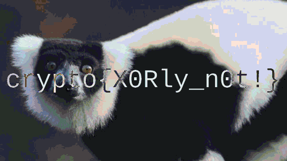

# Visual XOR Cryptanalysis & Key Reuse: Lemur XOR

## Platform & Metadata

| Field | Details |
| :--- | :--- |
| **Platform** | [CryptoHack](https://cryptohack.org/) |
| **Challenge Name** | Lemur XOR |
| **Topic / Category** | Introduction to CryptoHack — Symmetric XOR & Key Reuse (Two-Time Pad) |
| **Difficulty** | Beginner (`40 pts`) |
| **Challenge Files** | `lemur.png` (`lemur_ed66878c338e662d3473f0d98eedbd0d.png`)<br>`flag.png` (`flag_7ae18c704272532658c10b5faad06d74.png`) |
| **Tools Used** | Python 3 (`Pillow` / `PIL`), Ubuntu WSL Terminal, Windows Image Viewer |

> **Warning:** All cryptanalysis techniques and scripts documented in this write-up were executed exclusively against challenge artifacts provided by the authorized **CryptoHack** training platform.

---

## Objective

Exploit a cryptographic **key reuse vulnerability** (also known as a **Two-Time Pad** attack) where two PNG images (`lemur.png` and `flag.png`) were encrypted by XORing their RGB pixel bytes with the **same secret key**, and perform a pixel-by-pixel visual XOR between the two encrypted images to recover the hidden flag without knowing the secret key.


---

## Prerequisites

- Access to the **CryptoHack** platform and the downloaded challenge files (`lemur.png` and `flag.png`).
- Python 3 installed in a Linux or WSL virtual environment (`.venv`) with the **Pillow (`PIL`)** image-processing library (`pip install pillow`).
- Understanding of **Exclusive OR (`XOR`)** algebraic properties and RGB image pixel channels.

---

## Concept & Vulnerability Overview

### Algebraic Properties of XOR ($\oplus$)
The **Exclusive OR (`XOR`, $\oplus$)** operation compares two bits and outputs `1` if the bits differ and `0` if they are identical. It obeys four critical algebraic rules:

1. **Identity:** $A \oplus 0 = A$
2. **Self-Inverse:** $A \oplus A = 0$
3. **Commutativity:** $A \oplus B = B \oplus A$
4. **Associativity:** $A \oplus (B \oplus C) = (A \oplus B) \oplus C$

### The Key Reuse Vulnerability (Two-Time Pad)
In this challenge, two original plaintext images—$I_{\text{lemur}}$ and $I_{\text{flag}}$—were encrypted using the **exact same secret key stream** $K$:

$$C_1 = I_{\text{lemur}} \oplus K$$

$$C_2 = I_{\text{flag}} \oplus K$$

When an analyst XORs the two encrypted images ($C_1$ and $C_2$) together, the unknown secret key $K$ cancels itself out completely due to the self-inverse and associative properties of XOR:

$$C_1 \oplus C_2 = (I_{\text{lemur}} \oplus K) \oplus (I_{\text{flag}} \oplus K) = I_{\text{lemur}} \oplus I_{\text{flag}} \oplus (K \oplus K) = I_{\text{lemur}} \oplus I_{\text{flag}} \oplus 0 = I_{\text{lemur}} \oplus I_{\text{flag}}$$

### Why RGB Channel XOR Is Required Instead of Raw File Byte XOR
A `.png` file contains structured file headers (`89 50 4E 47...`), metadata chunks (`IHDR`, `IDAT`, `IEND`), and zlib-compressed pixel streams. XORing the raw `.png` files directly on disk would corrupt the PNG file headers and compression structures, making the resulting file unopenable. Instead, we must decode both PNG files into uncompressed **Red, Green, Blue (`RGB`)** pixel matrices, XOR each corresponding `(R, G, B)` byte tuple, and save the output as a valid PNG image (`recovered.png`).

---

## Methodology & Step-by-Step Walkthrough

### 1. Inspecting the Encrypted Challenge Images
1. Download `lemur.png` (`lemur_ed66878c338e662d3473f0d98eedbd0d.png`) and `flag.png` (`flag_7ae18c704272532658c10b5faad06d74.png`) from the CryptoHack challenge page.
2. Open both images to inspect their dimensions and visual appearance. Both images measure `582 x 327` pixels and appear as random multicolored noise because their RGB values have been masked by the secret key:

   

   

### 2. Developing the Visual RGB XOR Script (`solve.py`)
1. In the Ubuntu WSL terminal, navigate to the directory containing the downloaded images and create `solve.py`:

   ```bash
   nano solve.py
   ```

2. Write a Python script using `PIL.Image` (or `ImageChops`) to load both images, verify their dimensions (`(582, 327)`), XOR their corresponding `(R, G, B)` pixel values across all coordinates, and save the combined result as `recovered.png`:

   ```python
   from PIL import Image

   # Load the two encrypted PNG images
   img1 = Image.open("lemur_ed66878c338e662d3473f0d98eedbd0d.png").convert("RGB")
   img2 = Image.open("flag_7ae18c704272532658c10b5faad06d74.png").convert("RGB")

   print(f"Image 1: {img1.size}")
   print(f"Image 2: {img2.size}")

   # Create a new image buffer for the XOR output
   width, height = img1.size
   recovered = Image.new("RGB", (width, height))

   pixels1 = img1.load()
   pixels2 = img2.load()
   out_pixels = recovered.load()

   # Perform pixel-by-pixel RGB byte XOR
   for x in range(width):
       for y in range(height):
           r1, g1, b1 = pixels1[x, y]
           r2, g2, b2 = pixels2[x, y]
           out_pixels[x, y] = (r1 ^ r2, g1 ^ g2, b1 ^ b2)

   recovered.save("recovered.png")
   print("[+] Visual XOR successful!")
   print("[+] Saved recovered.png")
   ```

### 3. Executing the Script and Viewing `recovered.png`
1. Run `solve.py` in the terminal and open the output image:

   ```bash
   python3 solve.py
   explorer.exe recovered.png
   ```

2. The terminal confirms that both images share dimensions `(582, 327)` and that `recovered.png` was generated:

   ```text
   (.venv) cyberflex@DESKTOP-CYBERFLEX:/mnt/c/Users/Cyberflex/Downloads$ nano solve.py
   (.venv) cyberflex@DESKTOP-CYBERFLEX:/mnt/c/Users/Cyberflex/Downloads$ python3 solve.py
   Image 1: (582, 327)
   Image 2: (582, 327)
   [+] Visual XOR successful!
   [+] Saved recovered.png
   (.venv) cyberflex@DESKTOP-CYBERFLEX:/mnt/c/Users/Cyberflex/Downloads$ explorer.exe recovered.png
   ```

   

   > **Note on Visual vs. String Extraction:** Because the flag is rendered visually inside the pixel matrix rather than stored as an ASCII string inside the PNG file metadata, running `strings recovered.png | grep -iE 'flag|skillbit|ctf'` returns no text output—confirming why inspecting the visual image (`recovered.png`) is essential.

   

---

## Findings & Evidence

Opening `recovered.png` displays the superposition of `lemur.png` and `flag.png` ($I_{\text{lemur}} \oplus I_{\text{flag}}$). With the secret key canceled out, the photograph of the lemur and the overlaid white flag text are clearly legible.

### Side-by-Side Comparison of Encrypted Inputs and Recovered Output


### Recovered Image (`recovered.png`)



### Captured Flag

```text
crypto{X0Rly_n0t!}
```

---

## Remediation & Cryptographic Security Takeaways

1. **Never Reuse a One-Time Pad or Stream Cipher Key:** A One-Time Pad (`OTP`) or stream cipher (such as `AES-CTR` or `ChaCha20`, which XOR a keystream with plaintext) achieves confidentiality **only if every key or `(key, nonce)` pair is used exactly once**. Reusing the same keystream across two plaintexts allows an attacker to XOR the ciphertexts together ($C_1 \oplus C_2 = P_1 \oplus P_2$), completely eliminating the secret key.
2. **Use Unique Nonces / Initialization Vectors (`IVs`):** Modern authenticated encryption modes (such as `AES-GCM` or `ChaCha20-Poly1305`) combine a secret key with a unique, non-repeating **nonce** for every encryption operation so that the generated keystream is never identical across two files or messages.
3. **Encrypt Data Using Authenticated Modes, Not Raw Pixel ECB/XOR:** Encrypting raw pixel arrays with a static key stream preserves spatial patterns when keys are reused or blocks repeat. Always encrypt full files using standard authenticated encryption (`AEAD`).

---

## Learning Outcomes

- Applied the self-inverse and associative properties of `XOR` ($K \oplus K = 0$) to eliminate an unknown secret key reused across two encrypted files.
- Distinguished between raw file-level byte manipulation (which corrupts PNG headers and compression) and pixel-level `RGB` channel manipulation using Python.
- Verified why visual cryptanalysis is required when sensitive text is embedded directly into image pixels rather than ASCII strings.
